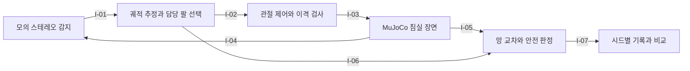

# D06 시스템 구조와 인터페이스 | 야간 침실 모기 요격 시뮬레이션

D06 · 시스템 구조 · 작성 gm(초안 보조 Codex) · 검토 gm 예정 · 상태 초안 · 버전 v0.2 · 관련 [D03](../requirements/requirements.md), [D07](../scene-inventory/scene-inventory.md), [D08](../safety-concept/safety-concept.md)

## 모듈 관계도

## 모듈 역할

| 모듈 | 맡은 일 | 구현 위치 | 관련 요구사항 |
|---|---|---|---|
| 모의 스테레오 감지 | 두 카메라 시점에서 모기의 위치를 투영한다. 시야와 가림을 검사하고 픽셀 잡음을 더해 삼각측량한다. 유효한 관측에 지연·누락을 적용한다. | `bedroom_demo.py`의 `_stereo_estimate()`, `run_episode()` | R-06 |
| 궤적 추정과 담당 팔 선택 | 전달된 위치를 평활화하고 연속 관측으로 속도를 추정한다. 예상 경로와 도달 시간을 비교해 구역별 담당 팔과 요격 후보를 고른다. 머리맡에서는 보호 구역 바깥 평면을 사용하고 머리맡 팔과 왼팔의 도달 후보를 비교한다. | `run_episode()`, `_pillow_gate_goal()`, `_choose_pillow_gate_candidate()` | R-03, R-04, R-06 |
| 관절 제어와 이격 검사 | 역기구학으로 관절 목표를 구하고 속도·가속도 제한을 적용한다. 역동역학으로 모터 명령을 계산하고, 머리맡 이격이 부족할 것으로 예측되면 명령을 거부하고 제동한다. | `_solve_arm_joint_goal()`, `_joint_reference_step()`, `_inverse_dynamics_controls()`, `_command_keeps_clearance()` | R-04, R-05 |
| MuJoCo 침실 장면 | UR10e 네 대, 침대, 사람 모형, 보호 구역, 표적과 조도 비교 조건을 구성한다. 10 ms마다 표적 궤적을 갱신하고 동역학을 한 틱 진행한다. | `build_bedroom_scene()`, `run_episode()` | R-01, R-04, R-05, R-07 |
| 망 교차와 안전 판정 | 연속 두 틱의 모기·망 위치와 회전으로 활성 망 접촉을 계산한다. 담당 팔과 접촉·운동 위반 이력을 확인하고 최초 진입·유효 포획·미결을 기록한다. | `_racket_contact_details()`, `_in_contact()`, `_inter_arm_contact()`, `run_episode()` | R-01, R-02, R-04, R-05 |
| 시드별 기록과 비교 | 기본 비교에서 같은 시드의 장치 없음·포충등·네 팔 결과를 대조한다. 조건별 진입, 유효 포획, 안전 감사와 베개 조도를 집계한다. | `bedroom_compare_100.py`, `bedroom_four_arm_benchmark.py` | R-01, R-03~R-07 |

표의 구현 위치는 시뮬레이션 모듈과 파일 이름이다. 제어는 기하 계산과 규칙 기반이며 학습 모델을 사용하지 않는다. 조준 입력은 지연이 적용된 추정치이고, 시뮬레이터의 실제 표적 위치는 모의 관측 생성과 평가에 사용한다.

## 인터페이스 표 (ICD)

| ID | 보내는 모듈 | 받는 모듈 | 데이터명 | 형식·필드 | 단위·좌표계 | 주기 또는 전달 조건 |
|---|---|---|---|---|---|---|
| I-01 | 모의 스테레오 감지 | 궤적 추정과 담당 팔 선택 | 위치 관측 | 획득 틱과 3차원 위치 또는 누락 | 틱, 월드 좌표 m | 5틱(50 ms)마다 관측을 시도하며 유효 관측은 50 ms 뒤 전달 |
| I-02 | 궤적 추정과 담당 팔 선택 | 관절 제어와 이격 검사 | 담당 팔과 요격 목표 | 팔 이름, 목표 위치, 6개 관절 목표 | 월드 좌표 m, rad | 새 유효 관측과 도달 가능한 후보가 있을 때 갱신 |
| I-03 | 관절 제어와 이격 검사 | MuJoCo 침실 장면 | 액추에이터 명령 | `data.ctrl` 24개, 일반 동작 또는 제동 | 위치형 제어 입력 rad. 역동역학 계산의 일반화 힘 N·m | 물리 틱마다 |
| I-04 | MuJoCo 침실 장면 | 모의 스테레오 감지 | 가림 계산 입력 | 표적 위치, 카메라 위치·방향, 장면 기하 | 월드 좌표 m, 회전 | 5틱마다 |
| I-05 | MuJoCo 침실 장면 | 망 교차와 안전 판정 | 물리 상태 | 직전·현재 모기와 망 위치, 망 회전, 접촉쌍과 관절 상태 | m, rad, rad/s, rad/s² | 물리 틱마다 |
| I-06 | 궤적 추정과 담당 팔 선택 | 망 교차와 안전 판정 | 요격 담당 팔 | `active_arm_owner` 또는 미지정 | 팔 이름 | 상태 갱신 후 해당 틱 판정에 사용 |
| I-07 | 망 교차와 안전 판정 | 시드별 기록과 비교 | 에피소드 결과 | 시드, 종료 틱, `entered`, `valid_arm_capture`, `unresolved`, 접촉·위반, `pillow_lux_peak` | 틱, 건, lx | 시험이 끝날 때 한 건 기록 |

## D08 안전 개념

보호 구역 접촉과 팔 간 접촉은 각각 기록한다. 머리맡 가까이에서는 예측 이격 50 mm를 확보하는 명령만 사용하고, 접촉 또는 운동 한계 위반이 있으면 해당 명중은 유효 포획에서 제외한다. 감지 조건과 제동 확인은 [D08 안전 개념](../safety-concept/safety-concept.md), 시험 절차는 [D04 추적표](../test-plan/test-plan.md)에 있다.
