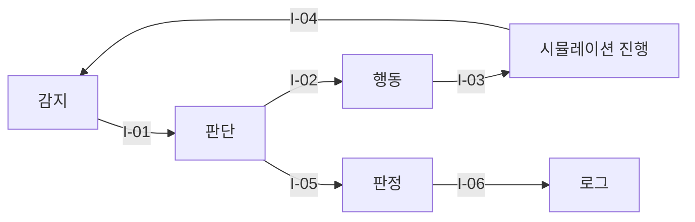

# D06 시스템 구조와 인터페이스 | [프로젝트명]

D06 · 시스템 구조 · 작성 [이름] · 검토 [이름] · 상태 [작성/검토/승인] · 버전 [v__] · 관련 [D03, D07, D08, R-xx]

## 모듈 관계도

상자 이름을 실제 모듈명으로 바꾸고, 화살표 번호를 인터페이스 표와 맞춘다. 감지에서 시작해 판단·행동·시뮬레이션 진행을 거친 뒤 다음 감지로 이어지는 고리와 판정·로그 경로를 표시한다.

## 모듈 역할

| 모듈 | 맡은 일 | 구현 위치 | 관련 요구사항 |
|---|---|---|---|
| [모듈명] | [무엇을 받아 어떤 결과를 만드는지] | [경로] | [R-xx] |

## 인터페이스 표 (ICD)

| ID | 보내는 모듈 | 받는 모듈 | 데이터명 | 형식·필드 | 단위·좌표계 | 주기 또는 전달 조건 |
|---|---|---|---|---|---|---|
| I-01 | [감지 모듈] | [판단 모듈] | [관측 데이터] | [자료형·필드] | [단위·좌표계] | [주기·이벤트] |
| I-02 | [판단 모듈] | [행동 모듈] | [목표 또는 제어 요청] | [자료형·필드] | [단위·좌표계] | [주기·이벤트] |
| I-03 | [행동 모듈] | [진행 모듈] | [액추에이터 명령] | [자료형·필드] | [단위] | [주기·이벤트] |
| I-04 | [진행 모듈] | [감지 모듈] | [센서 입력] | [자료형·필드] | [단위·좌표계] | [주기·이벤트] |
| I-05 | [판단 모듈] | [판정 모듈] | [판정에 쓸 관측값] | [자료형·필드] | [단위] | [주기·이벤트] |
| I-06 | [판정 모듈] | [로그 모듈] | [판정 결과] | [자료형·필드] | [단위 또는 해당 없음] | [주기·이벤트] |

## D08 안전 개념

[안전 개념 양식](../safety-concept/template.md)을 채운다. 강의 제출본에서는 그 내용을 이 절에 넣는다.
